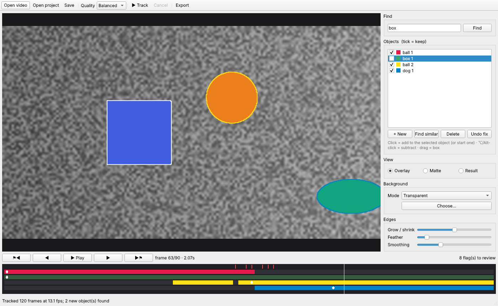

# BBG — Background Be Gone

On-device video background removal for Apple Silicon Macs with 16 GB of
unified memory. Type what to keep ("dog", "person") or click it, BBG tracks
it through the clip with Meta's SAM 3.1, you fix any frame it flags, and
export with the background removed or replaced. Nothing leaves the Mac.



*The screenshot uses the synthetic test backend, not SAM 3.1.*

Scope, decisions and plan: [SCOPE.md](SCOPE.md).

## Status

The v1 pipeline and GUI are built. It has **not yet run with the real SAM 3.1
weights**: that is Phase 0, which has to run on a Mac ([spike/](spike/README.md)).

| Part | State | How it was checked |
|---|---|---|
| Video in/out: exact frame index, VFR, rotation, backwards decoding | done | tests, against the FFmpeg CLI |
| Export: ProRes 4444 / WebM with alpha, PNG, matte, H.264/HEVC flattened, audio passthrough | done | tests decode the output and check alpha, timing and audio |
| HEVC with alpha (`hevc_videotoolbox`) | written | **untested**: needs macOS |
| Tracking: keyframes, nearest-keyframe ownership, partial re-tracking, re-detection of typed phrases, flags | done | tests with the synthetic backend (J > 0.95 against ground truth) |
| SAM 3.1 backend (mlx-vlm 0.7.11) | done | `tests/test_sam3_backend.py` (3 tests, passing) runs mlx-vlm's real SAM 3.1 code with random weights in a shallow, narrow config. It checks phrase detection, clicks with refinement, session start, object order on add, that tracker memory stays bounded, and the full tracker loop through the backend. **Mask quality and speed: not measured** (needs the real weights on a Mac) |
| GUI (PySide6) | done | offscreen end-to-end test: select, track, view modes, export |
| Phase 0 spike harness | done | dry run with the synthetic backend |
| macOS packaging (`.app`) | config only | `[tool.briefcase]` in pyproject; not built |

## Install

There is no double-click app yet. You install BBG from source with Python,
once, and then start it from Terminal.

> These steps haven't been run on a Mac yet (BBG was built and tested on
> Linux). If a step fails, the error message is what's needed to fix it.

### What you need

- **A Mac with Apple Silicon** (M1 or later) and **macOS 14 or later.** SAM 3.1 runs on the Mac's GPU through Apple's MLX, which doesn't exist for Intel Macs.
- **16 GB of memory or more.**
- **About 3 GB of free disk:** roughly 1 GB for the software, 1.8 GB for the model.
- **An internet connection** for installing. After that, BBG runs offline.

### 1. Install Python and Git (once)

Open **Terminal** (Applications → Utilities). Check whether Git is there:

```bash
git --version
```

If macOS offers to install the *command line developer tools*, accept, wait
for it to finish, and run `git --version` again.

BBG needs **Python 3.11 or newer**. The Python that comes with the developer
tools (3.9) is too old. The simplest route is the official installer:

1. Download **Python 3.12** for macOS from [python.org/downloads/macos](https://www.python.org/downloads/macos/) and run it.
2. Check it worked:

   ```bash
   python3.12 --version
   ```

   ```bash
   python3.12 -c "import platform; print(platform.machine())"
   ```

   The second command must print `arm64`. If it prints `x86_64`, that Python
   runs under Rosetta and MLX won't install. Use the macOS 64-bit universal2
   installer from python.org, or Homebrew on Apple Silicon.

If you use [Homebrew](https://brew.sh), `brew install python@3.12` does the same.

### 2. Get BBG

Until it is merged into `main`, the code is on the branch
`claude/gracious-turing-4xx1s7`. This puts it in a `BBG` folder in your home folder:

```bash
cd ~ && git clone --branch claude/gracious-turing-4xx1s7 https://github.com/ParadoxTurnedSolution/BBG.git
```

The repository is private, so Git will ask you to sign in to GitHub. When it
asks for a password, give it a *personal access token*, not your account
password (GitHub → Settings → Developer settings → Personal access tokens).
Or sign in once with the GitHub CLI (`brew install gh`, then `gh auth login`)
and Git will use that.

### 3. Install BBG and its libraries

This makes a private Python environment inside the `BBG` folder, so nothing
is installed system-wide:

```bash
cd ~/BBG && python3.12 -m venv .venv
```

```bash
source .venv/bin/activate
```

```bash
pip install --upgrade pip && pip install -e ".[sam3,gui]"
```

This takes a few minutes. It installs MLX, mlx-vlm (SAM 3.1), PySide6 (the
window), PyAV (FFmpeg) and OpenCV.

### 4. Download the model (once)

```bash
bbg-cli download-model
```

It shows the SAM License terms and asks you to accept. Then it downloads
`mlx-community/sam3.1-bf16` (about 1.8 GB) into `~/.cache/huggingface`.
You can skip this step: the app asks the same question the first time it
starts.

If the download stops with an access or login error, the model page wants
a Hugging Face account:
1. Create a free account at [huggingface.co](https://huggingface.co).
2. Open the model's page and accept its terms if it asks.
3. Make a read token (Settings → Access Tokens), then run:

   ```bash
   hf auth login
   ```

4. Run `bbg-cli download-model` again.

### 5. Start it

```bash
bbg
```

Or open a clip straight away:

```bash
bbg ~/Movies/clip.mov
```

**Every new Terminal window** needs the environment switched on before `bbg` works:

```bash
cd ~/BBG && source .venv/bin/activate
```

### Check the install without the model

This runs the whole pipeline on a generated test clip (a ball, a box and a
"dog" in flat colours), using a stand-in that segments by colour instead of
SAM 3.1. It finishes in seconds:

```bash
bbg-cli demo ~/bbg-demo
```

It writes `~/bbg-demo/demo_prores4444.mov` with the box removed. To try the
window on the same clip:

```bash
bbg --backend synthetic ~/bbg-demo/demo.mp4
```

The stand-in only understands those test clips. On real footage, use plain `bbg`.

### Updating

```bash
cd ~/BBG && source .venv/bin/activate && git pull && pip install -e ".[sam3,gui]"
```

### Uninstalling

Delete the `~/BBG` folder. The model is in
`~/.cache/huggingface/hub/models--mlx-community--sam3.1-bf16`; delete that too
to free its 1.8 GB. Each clip's project is a `.bbg` folder next to the clip.

### If something goes wrong

| Problem | Fix |
|---|---|
| `command not found: bbg` | The environment isn't switched on: `cd ~/BBG && source .venv/bin/activate` |
| `No matching distribution found for mlx` | Python isn't arm64 (step 1 check), or is older than 3.11 |
| `requires a different Python` | Use `python3.12` when making the environment (step 3) |
| The window doesn't open, or Qt errors | Run `pip install --force-reinstall PySide6-Essentials` inside the environment |
| Download fails with 401/403 | See the Hugging Face login steps in step 4 |
| It's slow or the Mac swaps | Quit other apps; choose *Fast* quality. That and the 16 GB budget are exactly what Phase 0 measures |

## Use

**GUI.** Open a clip, then:
- **Find:** type a short phrase. Every match becomes an object.
- **Click** to start an object or add to the selected one. **⌥-click** subtracts.
- **Drag** a box for a new object. With *Find similar* on, the box finds every look-alike instead.
- **▶ Track.** The timeline shows where each object is, its keyframes (◆) and flags (red).
- Jump between flags with ⚑◀ / ▶⚑. Click to fix a frame, then Track again: only that span is re-tracked.
- **Merge into…** folds a duplicate (say, "ball 2" after the ball re-emerged) into the original. Track again afterwards.
- Untick objects you don't want, choose a background, then **Export**.

**CLI.**

```bash
bbg-cli track clip.mov --phrase person --click 812,430@120 --report track.json
bbg-cli export clip.bbg out.mov --format prores4444
bbg-cli export clip.bbg out.mp4 --format h264 --background blur
bbg-cli export clip.bbg out.mp4 --format hevc --background image:beach.jpg --keep "person 1"
```

Formats: `prores4444`, `hevc_alpha` (macOS), `webm`, `png` (with alpha);
`matte`; `h264`, `hevc` (need a background). Click and box coordinates are
source pixels, `@frame` optional.

## How it works

```
src/bbg/
  video/reader.py    exact frame index from a packet scan; forwards and chunked-backwards decode
  video/writer.py    export formats, source timestamps, audio passthrough
  backends/          the Segmenter interface; SAM 3.1 on MLX; the synthetic test backend
  selection.py       phrase / click / box / find-similar on one frame → objects with keyframes
  tracking.py        planning (who owns each frame) and the tracking loop, re-detection, flags
  masks/             on-disk mask cache; guided upsampling, grow/shrink, feather, temporal smoothing
  export.py          kept objects over a background, full resolution
  project.py         the .bbg project folder
  gui/               PySide6 window; the engine thread that owns the model
  cli.py, metrics.py, memory.py, synthetic.py
spike/               Phase 0 measurement harness
```

**Memory stays flat with clip length.**
- Frames are decoded a few at a time.
- Masks go to disk as soon as they're made: one PNG per object per frame, at most 1024 px on the long side.
- The tracker keeps only the frames its memory can still reach. mlx-vlm 0.7.11 prunes the rest, and `tests/test_sam3_backend.py` checks it.

**Re-tracking is local.**
- Every frame is tracked from its nearest keyframe of that object.
- The project records which keyframe (and which version of its mask) produced each frame.
- After a correction, only frames whose owner changed are re-tracked.

**Edges.**
- The model's mask (1024 px) is upsampled to full resolution with a fast guided filter, so its edge lands on the picture's edge.
- It is then sharpened to a clean edge, and your Grow/Shrink and Feather settings are applied.

## Development

```bash
pip install -e ".[gui,dev]"
QT_QPA_PLATFORM=offscreen pytest                 # fast suite (synthetic backend, GUI offscreen)
pip install "mlx[cpu]" mlx-vlm==0.7.11           # Linux: CPU MLX for the next line
pytest -m slow                                   # SAM 3.1 plumbing, random weights
```

The slow tests build mlx-vlm's SAM 3.1 with random weights in a shallow
configuration: one backbone layer, one detector layer. On Linux, MLX's CPU
build is single-threaded: the three tests take about 35 minutes. On a Mac
they run on Metal.

`mlx-vlm` is pinned: `backends/sam3_mlx.py` calls its SAM 3.1 internals, and
the docstring there lists what it relies on.

## Licences

- **BBG's code:** Apache-2.0 ([LICENSE](LICENSE)).
- **SAM 3.1 weights:** Meta's SAM License, not Apache-2.0. They are downloaded at first run, after a prompt, and never shipped with BBG.
- **mlx-vlm's SAM 3.1 port:** mlx-vlm itself is MIT, but this port is derived from Meta's SAM 3 code.
- **FFmpeg:** PyAV's prebuilt wheels bundle an FFmpeg build that includes GPL encoders (x264, x265). Before distributing a packaged `.app`, either meet the GPL for that bundle or build PyAV against an LGPL FFmpeg.

## Known limitations

- **No real-weight results yet.** Mask quality, speed and peak memory on a 16 GB Mac are unmeasured until Phase 0.
- **Short phrases only.** SAM 3.1 is built for short phrases. For "the man on the left", type "man" and untick the others.
- **Duplicate objects.** Re-detection can create a duplicate when a tracked object re-emerges somewhere its track didn't follow: it appears as e.g. "ball 2". Both are kept by default, so the output is right. Use *Merge into…* to tidy the list.
- **Fast quality is approximate.** It tracks every other frame and averages the skipped frames from their neighbours. Fast motion will lag on those frames.
- **Shadows and reflections aren't included.** They aren't part of the object (SCOPE §13).
